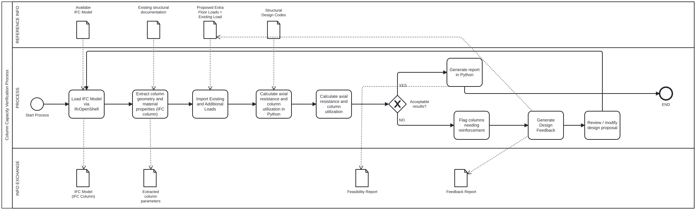
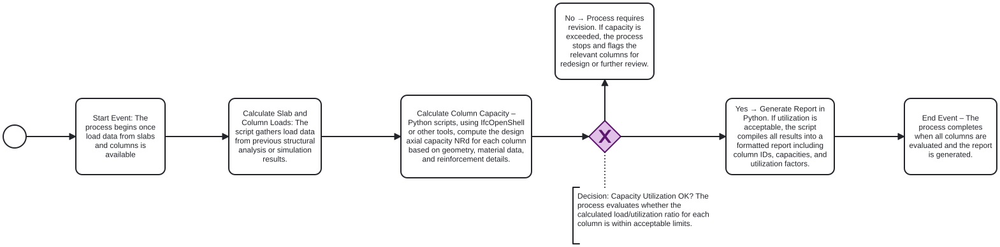

# 41934 AdvanceBIM

**Group members**

- Gulshan Kumar  (s252589)
- Aida Amirbabaei (s216201)

**Group number**: 24

## A2a: About our group
- **Focus area:** Structural Analysis
- **Role:** Analyst
- **I am confident coding in Python:** 0 - Strongly Disagree (This is the first time that both of us are coding in Python.)

## A2b: Identify Claim
* **Selected Building:** Building 2608 (using report '26-08-A-ClientReport-Anon').
* **Claim:** The existing structural system has sufficient reserve capacity to accommodate the additional loads from a vertical extension of up to two to three floors, except for highly utilized columns and S206 columns.[cite: 24]. 
* **Description of the Claim:** We want to calculate the current axial capacity of the existing structural columns and compare it against the new load conditions. This will tell us if the columns are strong enough to support the extra weight of a new top floor. 
* **Justification:** This claim was selected because the feasibility of adding two to three new floors depends directly on the capacity of the existing structural system. The report states that many structural elements are under-utilized, but it also identifies highly utilized columns and S206 columns as critical exceptions. Therefore, checking the remaining capacity of the existing columns is important to verify whether the proposed vertical extension is structurally feasible and to identify where strengthening, replacement, or redesign may be required.[cite: 24].

## A2c: Use Case
**1. How would you check this claim?**
  1. Check the current strength of the columns:
   * Extract the dimensions and geometry of the columns from the IFC model[cite: 31].
   * Check the concrete material properties[cite: 31].
   * If the reinforcement data is missing, we will just assume a minimum standard amount[cite: 31].
   * Calculate how much weight the columns can currently hold[cite: 31].
2. Apply the new loads:
   * Calculate the extra dead load from the new super-light concrete floor[cite: 17].
   * Add the standard Danish imposed load requirement of 4.5 kN/m²[cite: 17].
3. Compare the new loads with the existing column capacity to see if the results are acceptable[cite: 31].
4. Generate a report that shows which columns pass and which ones fail[cite: 31].
**2. When would this claim need to be checked?**
During the design phase, when the architects and engineers are trying to figure out if adding a floor is actually possible[cite: 31].
**3. What information does this claim rely on?**
Mainly the dimensions of the columns in the IFC model, and the weight of the new floor materials[cite: 31].
**4. What phase?**
Design Phase[cite: 31].
**5. What BIM purpose is required?**
Analyse[cite: 31].
**6. Closest BIM Use Cases:**
* **08: Engineering Analysis:** Ensures structural safety and compliance with building codes[cite: 31].
* **xx: Adaptive Reuse Analysis (Custom):** Checking old structures so we can expand them safely instead of tearing them down[cite: 31].

### Process BPMN Diagram

## A2d: Scope the use case
The specific scope for our Python tool is just the math and reporting part. It will automatically extract the column geometry, import the new floor weights, calculate if the columns are strong enough, and generate a final pass/fail report.

### Process BPMN Diagram

## A2e: Tool Idea
* **Description:** Our idea is to build a Python tool using IfcOpenShell to automatically check if existing columns can support a new floor[cite: 31]. The script will read the IFC model to get the column sizes and concrete grades[cite: 31]. Then, it will apply the new floor loads and check the utilization ratio[cite: 31]. Finally, it prints a report telling the engineers exactly which columns need to be made bigger[cite: 31].
* 
* **Business Value:**
* * **Saves Time:** It automates boring manual calculations, reducing the time engineers spend on data transfer[cite: 31].
* **Early Risk Detection:** It helps designers know right away if their idea for an extra floor is too heavy, avoiding expensive redesigns later[cite: 31].
**Societal Value:**
* **Sustainability:** Adding a floor to an old building is much better for the environment than tearing it down. This tool helps avoid wasting materials by preventing over-dimensioning[cite: 31].
* **Safety:** It makes sure the old columns won't collapse under the new modern load requirements[cite: 31]..

## A2f: Information Requirements
* **Information needed from the model:** Column dimensions, number of columns, and concrete design values[cite: 31].
* **Where is this in IFC?** We assume this data is inside `IfcColumn` and standard property sets[cite: 31].
* **Is it in the model?** The geometry is there, but data about the steel reinforcement is probably missing, so we will have to assume the minimum[cite: 31].
* **How to get it in IfcOpenShell?** We will write a script to pull the data from `IfcColumn`.
* **Learning Requirements:** We need to learn how to use Python to get data out of an IFC model, run the math, and print a text report[cite: 31].

## A2g: Identify Appropriate Software License
We will use Python and Blender 4.5 as our main software[cite: 31]. We will probably release the final code under an open-source license like MIT. a permissive open-source license that allows free use, modification, and distribution with minimal restrictions. It is ideal for educational OpenBIM tools and encourages collaboration within the AEC industry.
