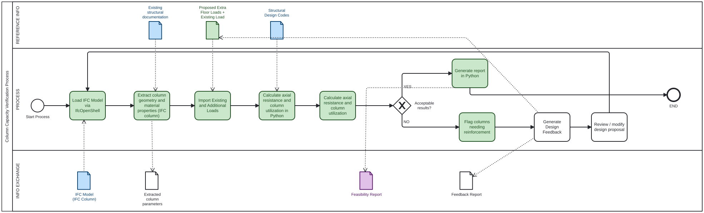

# 41934 AdvanceBIM

**Group members**

- Gulshan Kumar  (s252589)
- Aida Amirbabaei (s216201)

**Group number**: 24

## A2a: About our group
- **Focus area:** Structural Analysis
- **Role:** Analyst
- **I am confident coding in Python:** 0 - Strongly Disagree (This is the first time that both of us are coding in Python.)

## A2b: Identify Claim
* **Selected Building:** Building 2608 (using report '26-08-A-ClientReport-Anon').
* **Claim:** The existing structural system has sufficient reserve capacity to accommodate the additional loads from a vertical extension of up to two to three floors, except for highly utilized columns and S206 columns.[cite: 24]. 
* **Description of the Claim:** We want to calculate the current axial capacity of the existing structural columns and compare it against the new load conditions. This will tell us if the columns are strong enough to support the extra weight of a new top floor. 
* **Justification:** This claim was selected because the feasibility of adding two to three new floors depends directly on the capacity of the existing structural system. The report states that many structural elements are under-utilized, but it also identifies highly utilized columns and S206 columns as critical exceptions. Therefore, checking the remaining capacity of the existing columns is important to verify whether the proposed vertical extension is structurally feasible and to identify where strengthening, replacement, or redesign may be required.[cite: 24].

## A2c: Use Case

### 1. How to check the claim?

The claim will be checked by performing a preliminary structural capacity assessment of the existing columns under the additional vertical loads caused by the proposed vertical extension.

The process consists of:

1. Load the existing IFC model.
2. Extract the geometry and available material properties of the existing structural columns from the IFC model, primarily from `IfcColumn`.
3. Obtain any additional structural information required for the capacity calculation, such as reinforcement data, existing design loads, and material properties from the original structural documentation where this information is not available in the IFC model.
4. Determine the existing loads acting on the relevant columns.
5. Define the additional permanent and variable loads produced by the proposed vertical extension.
6. Apply the relevant load combinations and partial safety factors according to the applicable structural design standards.
7. Calculate the axial load-bearing capacity of the relevant existing columns.
8. Calculate the resulting column utilization under the combined existing and additional loads.
9. Compare the calculated utilization with the allowable capacity.
10. Identify columns that have sufficient capacity and flag columns that require further structural assessment, strengthening, replacement, or redesign.
11. Generate a structural assessment report showing the utilization and status of the checked columns.

### 2. When this claim need to be checked?

The claim should be checked during the design phase, before the vertical extension is approved and developed in detail. The assessment can help the structural engineer determine whether the proposed additional floors are feasible and identify critical existing columns at an early stage.

### 3. What information does the claim rely on?

The assessment requires:

- Existing column geometry and dimensions
- Column locations
- Column material properties
- Available reinforcement information
- Existing loads on the columns
- Additional dead loads from the proposed extension
- Additional imposed loads
- Relevant structural design parameters and safety requirements

The IFC model is used to obtain available geometric and material information about the structural columns. Additional loading and structural design information may need to come from external engineering data or assumptions where this information is not contained in the IFC model.

### 4. Phase

**Design phase**

The check is carried out while evaluating the feasibility of the proposed vertical extension.

### 5. BIM Purpose

**Analyse – Validate**

The main BIM purpose is **Analyse**, specifically to validate whether the existing structural columns have sufficient capacity for the additional loading.

Secondary purposes include **Gather**, because information is extracted from the IFC model, and **Communicate**, because the results are presented to the structural engineer in a report.

### 6. Closest BIM Use Case

The closest existing BIM use case is:

**08: Structural Analysis**

This BIM use case describes the use of BIM information together with structural analysis methods to evaluate the behaviour and performance of a structural system.

Our use case applies this principle to an existing building by checking the capacity of existing columns under additional vertical loads from a proposed building extension.

### 7. Process BPMN Diagram

The editable BPMN file is available here:

[A2c Process BPMN](IMG/A2c_process_diagram.bpmn)

## A2d: Scope the Use Case

A new Python/IfcOpenShell script is needed to automate the repetitive data extraction, load processing, structural capacity calculations, utilization checks, and reporting that would otherwise require manual transfer and calculation.

### Scoped BPMN Diagram

The editable BPMN file is available here:

[A2d Scoped BPMN](IMG/A2d_scoped_diagram.bpmn)

## A2e: Tool Idea
* **Description:** Our idea is to develop an OpenBIM structural assessment tool in Python using IfcOpenShell. The tool will read the IFC model and extract the required parameters from existing structural columns, primarily `IfcColumn`, including geometry and available material information. Additional structural information and load data that are not available in the IFC model can be provided as external inputs.

The Python tool will then apply the relevant load combinations and partial safety factors, calculate the axial resistance and utilization of the existing columns under the combined existing and additional loads from the proposed vertical extension, and compare the results with the allowable capacity.

The tool will generate a structural assessment report showing the column ID, calculated resistance, utilization ratio, and assessment status. Columns that exceed the acceptable utilization will be flagged for further structural assessment, strengthening, replacement, or redesign.

* **Business Value:**
* * **Saves Time:** It automates boring manual calculations, reducing the time engineers spend on data transfer.
* **Early Risk Detection:** It helps designers know right away if their idea for an extra floor is too heavy, avoiding expensive redesigns later.
**Societal Value:**
* **Sustainability:** Adding a floor to an old building is much better for the environment than tearing it down. This tool helps avoid wasting materials by preventing over-dimensioning.
* **Safety:** It makes sure the old columns won't collapse under the new modern load requirements.

## A2f: Information Requirements

| Requirement | Where in IFC | In our model? | How to get it with IfcOpenShell | Learning need |
|---|---|---|---|---|
| Units | `IfcProject.UnitsInContext` | To verify | Read the project units | Read and convert IFC units |
| Column elements | `IfcColumn` | Yes | `model.by_type("IfcColumn")` | Extract `IfcColumn` elements |
| GlobalId | `IfcColumn.GlobalId` | Yes | `column.GlobalId` | Extract GlobalId from IFC elements |
| Column geometry / dimensions | `IfcColumn` geometry / profile representation | Yes / to verify | Read geometry or profile data | Extract column dimensions |
| Column location / storey | `IfcLocalPlacement`, spatial relationships | Yes / to verify | Read placement and storey relationships | Extract location and storey |
| Material information | `IfcRelAssociatesMaterial` → `IfcMaterial` | To verify | Read material associations | Extract material properties |
| Reinforcement information | Reinforcement-related IFC entities or external documentation | To verify | Check IFC for reinforcement data | Find and extract reinforcement data |
| Existing + additional loads | Structural data / external input | Partly external | Import load data into Python | Combine IFC and external load data |

Load combinations, partial safety factors, axial resistance, utilization, and assessment results will be calculated in Python and are therefore not required to be extracted directly from the IFC model.

## A2g: Identify Appropriate Software License
We will use Python and Blender 4.5 as our main software[cite: 31]. We will probably release the final code under an open-source license like MIT. a permissive open-source license that allows free use, modification, and distribution with minimal restrictions. It is ideal for educational OpenBIM tools and encourages collaboration within the AEC industry.
